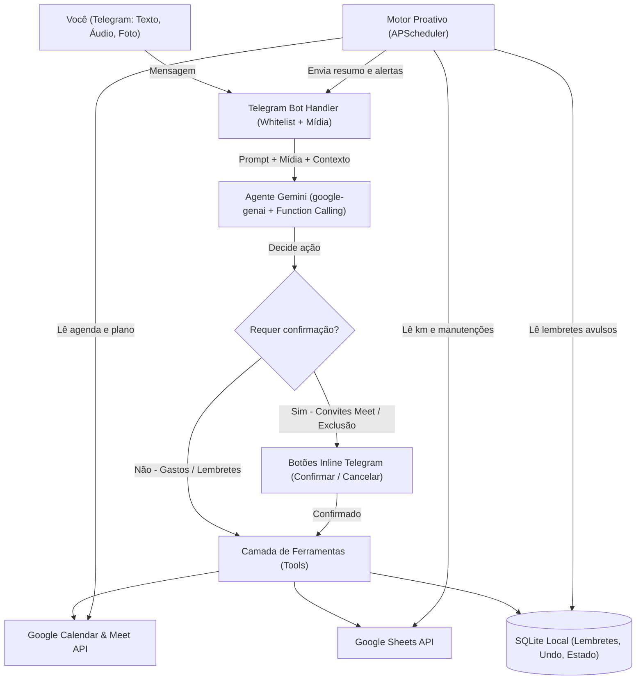

# Plano de Arquitetura e Viabilização — Assistente Pessoal (Telegram + Gemini + Google)

Este documento consolida o entendimento levantado e define o plano técnico para construir seu assistente pessoal 24/7 conectado ao Telegram, usando o Gemini como cérebro multimodal e integrando com sua conta Google pessoal.

---

## 1. Resumo das Decisões Alinhadas

- **Stack e Código**: Projeto próprio em **Python** (versionado neste repositório), utilizando `python-telegram-bot`, camada agnóstica de LLM (`BaseLLMProvider` com padrão **Gemini Free Tier** via `google-genai`, além de suporte a **Claude/Anthropic** e **OpenAI-compatible** para OpenRouter `:free`, Groq e Ollama), `google-api-python-client` e `gspread`.
- **Infraestrutura**: Containerizado com **Docker** para desenvolvimento/testes locais e deploy 24/7 em **VPS/servidor Linux**.
- **Controle de Acesso**: Chat privado no Telegram com **whitelist** via `TELEGRAM_ALLOWED_USER_IDS` para integridade e segurança, com documentação passo a passo no `README.md` para qualquer nível de usuário.
- **Interação Multimodal e Governança de Mídia**: Entrada por **texto livre, áudio/voz e fotos** (cupons fiscais, painel/odômetro do carro). Áudios e imagens são processados **em memória (`BytesIO`)** e descartados imediatamente após a resposta (Política de Retenção Zero para Mídia), com fallback `STT_PROVIDER` (ex: Groq Whisper gratuito) quando o LLM escolhido não aceitar áudio nativo.
- **Saídas Estruturadas (Structured Outputs)**: Duas camadas obrigatórias — (1) schemas **Pydantic / JSON Schema estrito** para extração de dados e parâmetros de *tools*, e (2) **templates determinísticos** (`src/bot/formatters.py`) para respostas padronizadas no Telegram.
- **Governança de Dados Locais**: Job periódico de higienização (`Housekeeping`) no `APScheduler` com `DATA_RETENTION_DAYS` configurável no `.env` para expurgo de histórico antigo no SQLite e eventuais resíduos temporários.
- **Escopo do MVP Google**: **Google Calendar**, **Google Meet** e **Google Sheets** (arquitetura modular de *tools* para plugar Gmail, Drive e Tasks nas próximas fases).
- **Planilhas**: Criação de **novas planilhas estruturadas** no Google Sheets (Controle Veicular + Orçamento Doméstico), com suporte posterior para importar os dados que você já tem no app do Gemini.
- **Motor Proativo**: Resumo matinal diário, alertas antecipados de compromissos do Calendar, lembretes avulsos/recorrentes e avisos de manutenção preventiva do carro (por km e por data).
- **Política de Confirmação**: Gastos pessoais e lembretes executam direto (com resumo e opção de desfazer/corrigir); convites do Meet para terceiros e exclusões pedem confirmação rápida por botões inline no Telegram.

---

## 2. Arquitetura do Sistema



### Estrutura de Diretórios Sugerida

```text
personal-assistant/
├── docker-compose.yml
├── Dockerfile
├── pyproject.toml / requirements.txt
├── .env.example
├── src/
│   ├── main.py                 # Entrypoint: inicia Bot + Scheduler
│   ├── config.py               # Variáveis de ambiente e whitelist
│   ├── bot/
│   │   ├── handlers.py         # Texto, áudio, foto e callback buttons
│   │   └── middleware.py       # Validação de user_id (whitelist)
│   ├── agent/
│   │   ├── gemini_client.py    # Orquestração multimodal + loop de tool calling
│   │   ├── system_prompt.py    # Personalidade, regras e data/hora atual
│   │   └── tools_registry.py   # Registro modular das ferramentas
│   ├── integrations/
│   │   ├── google_auth.py      # OAuth 2.0 + gerenciamento de refresh_token
│   │   ├── google_calendar.py  # Eventos e links do Google Meet
│   │   └── google_sheets.py    # Leitura, escrita e setup das planilhas
│   ├── scheduler/
│   │   └── jobs.py             # Resumo matinal, alertas de agenda, km e lembretes
│   └── storage/
│       └── database.py         # SQLite: lembretes, histórico para Undo, cache de alertas
└── scripts/
    ├── auth_google.py          # Script único para gerar o token OAuth inicial
    └── setup_sheets.py         # Script para criar as planilhas iniciais no Drive
```

---

## 3. Modelagem de Dados (Google Sheets + SQLite)

### Planilha 1: `Assistente - Controle Veicular`
1. **Aba `Abastecimentos`**: `ID | Data | Km Atual | Combustível | Litros | Valor Total | Preço/L | Posto | Km Rodados | Consumo (km/L) | Observações`
2. **Aba `Manutencoes_Realizadas`**: `ID | Data | Km | Serviço/Item | Oficina | Valor | Próxima Troca (Km) | Próxima Troca (Data) | Notas`
3. **Aba `Plano_Manutencao`**: `Item | Intervalo Km | Intervalo Meses | Último Km | Última Data | Próximo Km | Próxima Data | Status` (ex: Óleo e Filtro, Rodízio de Pneus, Pastilhas de Freio, Correia, Filtro de Ar)
4. **Aba `Despesas_Fixas_Outros`**: `ID | Data | Categoria (IPVA/Seguro/Lavagem/Estacionamento/Multa) | Descrição | Valor`

### Planilha 2: `Assistente - Orçamento Doméstico`
1. **Aba `Lancamentos`**: `ID | Data | Tipo (Despesa/Receita) | Categoria (Mercado/Saúde/Igreja/Casa/Lazer/Transporte/Outros) | Subcategoria | Descrição | Valor | Forma Pagamento`
2. **Aba `Metas_Orcamento`**: `Categoria | Limite Mensal | Alerta (%)` (para o bot avisar quando estiver perto do teto da categoria)
3. **Aba `Resumo_Mensal`**: Fórmulas `SUMIFS` automáticas cruzando `Lancamentos` x `Metas_Orcamento` por mês/ano.

### Banco Local (`SQLite`)
- **`users`**: `telegram_id`, `nome`, `role` (preparado para adicionar sua esposa depois).
- **`reminders`**: `id`, `user_id`, `titulo`, `horario_disparo`, `recorrencia` (cron/intervalo ou única), `status`.
- **`action_history`**: últimos registros gravados no Sheets/Calendar (ID da linha ou `event_id`) para suportar o comando **"desfazer último lançamento"** rapidamente.
- **`sent_notifications`**: evita enviar o mesmo alerta de evento ou manutenção duas vezes.

---

## 4. Catálogo de Ferramentas do Agente (MVP)

| Domínio | Ferramenta (Tool) | Comportamento |
| :--- | :--- | :--- |
| **Calendar & Meet** | `list_calendar_events` | Lista compromissos de hoje, semana ou período específico. |
| **Calendar & Meet** | `create_calendar_event` | Cria evento (consultas, igreja, etc.). Se solicitado Meet, gera link (`conferenceData`). Pede confirmação se houver convidados externos. |
| **Calendar & Meet** | `update_or_delete_event` | Reagenda ou cancela evento (exclusão sempre pede confirmação por botão). |
| **Sheets (Carro)** | `log_fuel_expense` | Registra abastecimento, calcula consumo e atualiza o último km conhecido do carro. |
| **Sheets (Carro)** | `log_car_expense` | Registra manutenção realizada ou despesa fixa; atualiza o `Plano_Manutencao`. |
| **Sheets (Carro)** | `get_car_maintenance_status` | Consulta próximos itens a vencer por km ou data. |
| **Sheets (Orçamento)** | `log_budget_expense` | Registra gasto (ex: mercado, farmácia) na planilha orçamentária. |
| **Sheets (Orçamento)** | `get_budget_summary` | Consulta total gasto no mês por categoria e compara com a meta. |
| **Lembretes** | `manage_reminders` | Cria, lista ou cancela lembretes avulsos/recorrentes no SQLite. |
| **Segurança / UX** | `undo_last_action` | Reverte a última gravação no Sheets ou Calendar. |

---

## 5. Autenticação Google (`@gmail.com`) — Ponto Crítico de Atenção

Para acessar Calendar, Meet e Sheets de uma conta `@gmail.com` pessoal:
1. Usaremos **OAuth 2.0** (Desktop App / Web App) configurado no **Google Cloud Console** com as APIs ativadas:
   - Google Calendar API
   - Google Sheets API
   - Google Drive API (apenas escopo `drive.file` ou necessário para criar/localizar as planilhas)
2. **Atenção ao status do App no Google Cloud**:
   - Enquanto a tela de consentimento OAuth estiver no modo **"Testing"**, o `refresh_token` expira automaticamente a cada **7 dias**.
   - **Solução**: Ao configurar, podemos manter apenas para seu e-mail de teste e **publicar o app** (sem precisar de verificação pública do Google para uso pessoal restrito, aceitando o aviso de "App não verificado" uma única vez no seu próprio login) ou renovar quando necessário. Publicando em modo produção para uso pessoal, o `refresh_token` deixa de expirar a cada 7 dias.

---

## 6. Roadmap de Execução em Fases

### Fase 0: Setup de Credenciais, Esqueleto Docker e Documentação Base
- Criar o bot no `@BotFather` do Telegram e pegar o token + `user_id` (`@userinfobot`).
- Gerar a chave gratuita da API do Gemini no Google AI Studio (ou outro provedor suportado).
- Configurar o projeto no Google Cloud Console (OAuth 2.0) e rodar o script de autenticação local para gerar o `token.json`.
- Subir estrutura inicial Python + `Dockerfile` + `docker-compose.yml`.
- **Documentação (Zensical)**: Configurar `zensical.toml`, serviço opcional no `docker-compose.yml` e publicar a página inicial (`docs/index.md`) + documentação da Fase 0.

### Fase 1: Core do Bot + Camada Multi-Provedor de LLM + Governança
- Implementar o bot no Telegram com middleware de whitelist (`TELEGRAM_ALLOWED_USER_IDS`).
- Implementar `BaseLLMProvider` (Gemini Free Tier como padrão multimodal; suporte a Anthropic/Claude e OpenAI-compatible + `STT_PROVIDER` fallback).
- Garantir mídia efêmera em memória (`BytesIO`), *Structured Outputs* (Pydantic + templates determinísticos) e job de higienização (`DATA_RETENTION_DAYS`).
- **Documentação (Zensical)**: Documentar fluxo de mensagens, configuração de provedores de LLM/STT, políticas de privacidade/higienização e exemplos de uso.

### Fase 2: Google Sheets (Planilhas + Carro + Orçamento)
- Script `setup_sheets.py` para criar as duas planilhas com formatação e fórmulas prontas no Google Drive.
- Implementar as *tools* de lançamento de abastecimento, manutenção, orçamento e consulta de resumos com schemas Pydantic estritos.
- *(Opcional)* Importar histórico existente para as novas planilhas.
- **Documentação (Zensical)**: Documentar a estrutura das planilhas, colunas, fórmulas e comandos/exemplos financeiros e veiculares.

### Fase 3: Google Calendar + Google Meet + Botões de Confirmação
- Implementar consulta, criação e edição de eventos (com criação automática de link do Google Meet).
- Implementar o fluxo de confirmação via botões inline (`Confirmar` / `Cancelar`) para convites com terceiros e exclusões.
- **Documentação (Zensical)**: Documentar permissões OAuth, fluxo de confirmação por botões inline e exemplos de agendamento com Meet.

### Fase 4: Motor Proativo (Scheduler)
- **Resumo Matinal** (`MORNING_SUMMARY_TIME`): agenda do dia + lembretes + alertas de manutenção.
- **Alertas Antecipados**: notificações 1 dia antes e 1h antes dos compromissos do Calendar.
- **Monitor de Manutenção**: avisa quando a quilometragem ou data se aproximar do limite de algum item do `Plano_Manutencao`.
- **Lembretes Avulsos/Recorrentes**: disparos exatos para tarefas rápidas.
- **Documentação (Zensical)**: Documentar o funcionamento dos jobs do `APScheduler`, configuração de `TIMEZONE` e gerenciamento de lembretes.

### Fase 5 (Expansão v2 — Futura)
- Suporte aprimorado a múltiplos usuários autorizados (ex: familiares na whitelist com agendas compartilhadas/individuais).
- Plugar novas *tools*: **Gmail** (resumo de e-mails), **Google Drive** (salvar fotos dos cupons fiscais vinculando o link na planilha) e **Google Tasks**.
- **Documentação (Zensical)**: Documentar as novas integrações (Gmail/Drive/Tasks) e o guia de migração/atualização.

---

## Próximo Passo
Se este plano estiver alinhado com o que você imaginou, podemos começar pela **Fase 0** (criando a estrutura do projeto Python + Docker e o guia exato de criação das chaves no Telegram, Gemini e Google Cloud).
